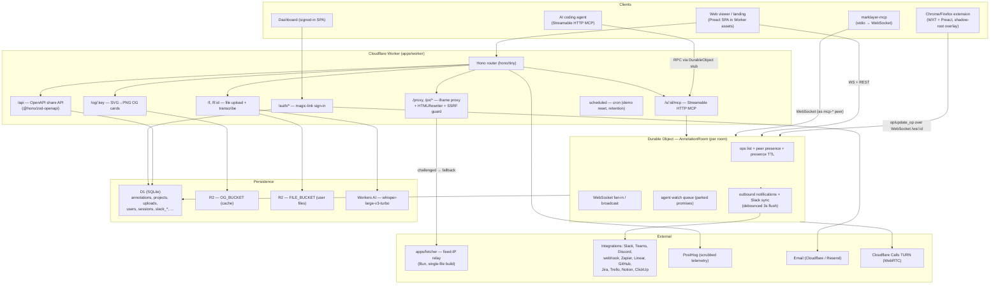
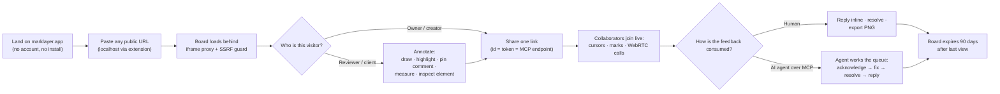
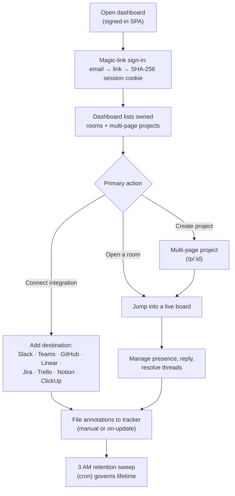
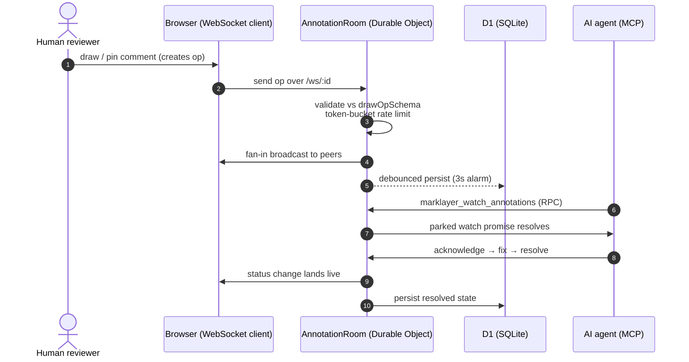

# MarkLayer — Architecture & Technical Analysis

> A detailed engineering and UX review of [`thevrus/MarkLayer`](https://github.com/thevrus/MarkLayer)
> (open-source, free webpage annotator with real-time collaboration and an MCP bridge for AI agents).
>
> Prepared: November 2, 2026 · Repository: `main` · ~65,900 lines of TypeScript/TSX across 8 workspaces, 82 test files.

---

## Table of contents

1. [Executive summary](#1-executive-summary)
2. [Product surface](#2-product-surface)
3. [High-level architecture](#3-high-level-architecture)
4. [Repository & monorepo layout](#4-repository--monorepo-layout)
5. [The domain model — an "everything is an op" stream](#5-the-domain-model)
6. [Component deep-dives](#6-component-deep-dives)
7. [Data model & D1 schema](#7-data-model--d1-schema)
8. [The real-time protocol](#8-the-real-time-protocol)
9. [The AI-agent / MCP surface](#9-the-ai-agent--mcp-surface)
10. [Security model](#10-security-model)
11. [Observability & telemetry](#11-observability--telemetry)
12. [Deployment & infrastructure](#12-deployment--infrastructure)
13. [Notable technical decisions](#13-notable-technical-decisions)
14. [Improvement suggestions](#14-improvement-suggestions)
15. [UX, dashboard & web product user flows](#15-ux-dashboard--web-product-user-flows)

---

## 1. Executive summary

MarkLayer turns any webpage into a collaborative review surface. The core product loop is
deliberately simple and low-friction:

1. **Open a page** — paste a public URL at `marklayer.app`, or use the Chrome/Firefox extension on a page you are already viewing (including `localhost`).
2. **Annotate** — pen, highlighter, shapes, arrows, text, text-selection copy-edits, area notes, element inspection, ruler guides, polls, and media notes (voice/video).
3. **Share one link** — the share id **is** the access token (no account required). Collaborators join the same board and see cursors, marks, replies, and calls in real time.
4. **Hand it to an AI agent** — every share link is *also* a remote MCP server at `/s/<id>/mcp`; an agent reads annotations as a structured work queue (acknowledge → fix → resolve → reply), or reviews the page itself and leaves its own comments and copy-edit suggestions.

Architecturally it is a **Cloudflare-native monorepo**:

- **Bun + Turborepo** monorepo, **TypeScript** (7.x; the Astro site pinned to 6.x), **Biome** for lint/format.
- **One Worker** (`apps/worker`) serves everything dynamic: the SPA, the share/annotate API, the real-time WebSocket Durable Object, the iframe proxy, magic-link auth, file uploads, OG images, and the Streamable-HTTP MCP endpoint.
- **One Durable Object class** (`AnnotationRoom`) owns per-room state: the op list, peer presence, WebRTC signaling, and the agent "watch" queue.
- **D1 (SQLite)** is the system of record; **R2** holds regenerable OG images and the only copies of uploaded files; **Workers AI** transcribes voice notes.
- A **fixed-IP fetch relay** (`apps/fetcher`) is the fallback for hosts that challenge Cloudflare's shared egress.
- A **static Astro marketing/SEO site** (`apps/site`) is embedded into the Worker's asset layer so marketing pages never invoke the Worker.

The codebase is unusually well-documented: a 22 KB `CLAUDE.md` encodes architecture rationale and conventions, and most non-obvious code paths carry a *why* comment rather than a *what* comment. This document synthesizes those sources with direct source inspection.

---

## 2. Product surface

The product ships as **five runtime surfaces**, all fed by the same shared type/op model:

| Surface | Runtime | Purpose |
|---|---|---|
| **Web viewer / landing** | `apps/worker/web` (Preact SPA) | Open a share link in any browser; annotate, review, compare versions, manage projects/folders, configure integrations. |
| **Dashboard** | `apps/worker/web/dashboard` | Signed-in "app": claim anonymous links, folders, link settings (view-only, password, expiry). |
| **Chrome/Firefox extension** | `apps/extension` (WXT + Preact) | Annotate the page you're already on (content script + shadow-root overlay), including `localhost`. |
| **MCP server (stdio)** | `apps/mcp` → npm `marklayer-mcp` | Same tools over stdio for clients that only run local servers. |
| **MCP server (remote)** | `apps/worker/src/mcp.ts` | Streamable HTTP at every `/s/<id>/mcp`; nothing installed. |
| **Marketing/SEO site** | `apps/site` (Astro) | 87 static content pages (compare, alternatives, use-cases, guides) + `llms.txt`, agent skills, MCP server card. |

A human reviewer and an AI agent are **first-class peers in the same room**: an agent appears in the presence list with its own brand color and name, and its status changes (acknowledge/resolve) land live in front of the human.

---

## 3. High-level architecture



**The defining architectural idea:** a room's share id is simultaneously its database primary key, its access token, its WebSocket namespace, *and* its MCP endpoint. There is one source of truth for a room's state — the `AnnotationRoom` Durable Object — and every surface (human viewer, extension, stdio MCP, HTTP MCP) reduces to "load ops, mutate op, broadcast, debounce-persist to D1."

---

## 4. Repository & monorepo layout

```
MarkLayer/
├── apps/
│   ├── extension/       Chrome/Firefox extension (WXT + Preact) — the overlay & tools
│   ├── worker/          Cloudflare Worker: API, realtime DO, proxy, auth, integrations, OG, SPA
│   ├── site/            Astro static marketing/SEO site (embedded into the Worker at build time)
│   ├── mcp/             MCP server (published to npm as `marklayer-mcp`) — stdio transport
│   └── fetcher/         Fixed-IP fetch relay (Bun, single-file ~3KB bundle)
├── packages/
│   ├── types/           Shared Zod schemas + types (op union, anchor, peers, integrations) — source of truth
│   ├── agent-tools/     The agent tool contract (no transport): tool specs, schemas, dispatch
│   └── emails/          React Email templates (sign-in, invite)
├── CLAUDE.md            Architecture + conventions (authoritative)
├── TRACKING.md          Telemetry plan (privacy-first)
├── biome.json / turbo.json / tsconfig.json / bun.lock
```

**Workspace graph** (from each `package.json`):

- `apps/worker` depends on `@marklayer/types`, `@marklayer/agent-tools`, `@marklayer/emails`, and `@marklayer/site` (build-time embed) — and imports extension components via an `@ext/*` path alias.
- `apps/extension` depends on `@marklayer/types` + `@marklayer/agent-tools` + Preact/Signals/Base UI.
- `apps/mcp` (the npm package) depends on `@marklayer/agent-tools` + `@marklayer/types` at build time, but its published `dist/cli.js` externalizes the MCP SDK, `ws`, `nanoid`, and `zod`.
- `packages/agent-tools` depends on `@marklayer/types`; `packages/types` depends only on `zod/mini` + `cnfast`.

**Line counts (TS/TSX/CSS/MJS, excl. tests where noted):**

| Workspace | Lines | Notes |
|---|---|---|
| `apps/worker` | ~33,600 | API, DO, proxy, auth, integrations, OG, **and** the whole web SPA |
| `apps/extension` | ~26,400 | ~45 components + ~45 `lib/` modules, many with paired `*.test.ts` |
| `apps/site` | ~7,400 | Astro templates + markdown collections |
| `packages/types` | ~2,370 | The schema/domain model |
| `packages/agent-tools` | ~2,000 | The agent contract |
| `apps/mcp` | ~1,180 | stdio server + room client |
| `packages/emails` | ~360 | React Email templates |
| `apps/fetcher` | ~340 | The relay |

Two `package.json` conventions stand out:

1. **`zod/mini`, never `zod`** — every shipped bundle uses the tree-shakable mini build with the functional API (`z.string().check(z.minLength(1), …)`, `z.discriminatedUnion`, `z.enum`). Only two deliberate exceptions: `apps/worker/src/api.ts` (needs `@hono/zod-openapi`'s re-export for spec generation) and `apps/site` (`astro/zod`).
2. **`apps/site` is pinned to `typescript@^6`** — its `check` is `astro check`, which needs the TS programmatic API that 7.x's native compiler doesn't ship yet. Bumping it would silently stop type-checking all 37 `.astro` templates.

---

## 5. The domain model — an "everything is an op" stream

The heart of the system is `packages/types/src/index.ts`. Everything a user or agent does is a **`DrawOp`**, a discriminated union on `tool`, validated by Zod and persisted as one JSON column (`annotations.ops`).

### 5.1 The op union

```ts
export const drawOpSchema = z.discriminatedUnion('tool', [
  freehandOpSchema,   // pen | eraser | highlight (point arrays)
  rectOpSchema,       // rectangle
  lineOpSchema,       // line (optional arrow)
  circleOpSchema,     // circle
  textOpSchema,       // text
  commentOpSchema,    // comment (threaded pin) + triage + mentions + reactions + attachments + voice/video
  selectionOpSchema,  // selection (copy-edit: text + suggestion diff + per-line rects)
  areaOpSchema,       // area (rectangular region + comment)
  inspectOpSchema,    // inspect (element handoff: selector + markdown snapshot + CSS styleEdits)
  guideOpSchema,      // guide (ruler line — persisted in the same stream)
  introOpSchema,      // intro (pinned walkthrough video)
  questionOpSchema,   // question (poll)
  voteOpSchema,       // vote (one ballot per voter)
  stepOpSchema,       // step (agent next-steps checklist item)
]);
```

Sixteen `tool` literal values. Notable design choices:

- **Guides and polls ride the same op stream** as marks — "everything is an op," so a ruler line persists, broadcasts, and synchronizes exactly like a pen stroke; `guides` is a *computed view* over `operations`, not separate state.
- **`resolved`/`approved` are two halves of one handoff, not synonyms** — the fixer marks `resolved`; the requester confirms `approved`. Status is a 5-value enum: `open | in_progress | resolved | approved | dismissed`.
- **Votes are individual ops**, not a map on the question — two simultaneous voters patching a shared map would have the later write clobber the earlier. A `voteOp` per voter makes the latest ballot win, no lock required.
- **`selection` carries a `suggestion` field** (the exact replacement text) separate from `comment` (the note about it) — so a copy edit renders/exportable as an *applyable diff*, not prose an agent must parse.
- **`inspect` carries the full AI-ready snapshot** — `selector`, `tag`, `markdown`, `rect`, `details` (id/classes/attributes/visible text/computed styles/component chain), and `styleEdits` (CSS the reviewer already tried live, as `property: from → to`).
- **Triage state** (`status`, `priority`, `assignee`, `assignedAgent`, `dismissReason`) is mixed into every annotation-kind op via a shared `triageable` spread.

### 5.2 Anchoring — how marks survive page reflow

Annotations bind to host-page elements through a `targetElementSchema` that captures, at draw time:

- a **stable CSS selector** (computed by `apps/extension/lib/selector.ts`),
- the **element rect** (document px),
- an **element-local `offsetX/offsetY`** from the element's top-left to the anchor point,
- a **text fingerprint** (`normalizeText(innerText).slice(0, 50)`) as a fallback for SPAs whose classes churn,
- the **`markdown` snapshot** (`formatForAI`) that agents read.

Re-anchoring (`apps/extension/lib/anchor.ts`) reprojects the anchor **fractionally**: `offsetX/offsetY` are scaled by `currentSize / capturedSize`, so a responsive reflow keeps the pin at the same relative position *inside* the element and scales area/selection extents with the element. The selector resolves first; on failure it falls back to a two-phase text-fingerprint scan (`textContent` prefilter → `innerText` verify → closest-to-captured-rect tiebreak). Failures are memoized until a `MutationObserver`-driven generation tick invalidates them.

**PDFs/images** (which pdf.js re-renders at every zoom, churning all selectors) use a separate `pageAnchorSchema` — page number plus a 0..1 fraction — which survives zoom and reprojects by multiplication.

**Deliberate limitation (documented):** canvas marks (pen/line/circle) stay in captured document coordinates. `captureScale()` is currently a no-op returning `1`, because the earlier `currentWidth/capturedWidth` heuristic drifted badly on long pages. Element-bound ops (comment/selection/area) are the fully-anchored subset; strokes are treated as "a gesture, not a region."

### 5.3 The wire protocol

`clientMsgSchema` is the strictly-validated client→server message union:

```ts
{ type: 'op', op }            // append a validated op
{ type: 'update_op', opId, patch }  // partial patch, re-validated by applyOpPatch()
{ type: 'undo', opId }        // remove
{ type: 'clear' }             // wipe
{ type: 'ping' }              // heartbeat (auto-answered by the runtime)
{ type: 'cursor', x, y, tool }// presence cursor
{ type: 'ripple', x, y }      // attention ping
{ type: 'profile', name?, color? } // rename/recolor
{ type: 'flock', on }         // "everyone follow me" presenter mode
```

WebRTC signaling (`rtc_offer/answer/ice/request_ice`) deliberately **bypasses** the strict schema (arbitrary SDP/ICE blobs) and is forwarded verbatim between peers.

**`applyOpPatch`** is the load-bearing safety valve: `update_op` carries an unconstrained `Record<string, unknown>` patch, so the DO re-merges and re-parses the op through `drawOpSchema` before broadcasting or persisting — a malformed patch can never corrupt the room.

---

## 6. Component deep-dives

### 6.1 `apps/worker` — the Cloudflare Worker

`apps/worker/src/index.ts` is a `Hono` app (`hono/tiny`) with a very deliberate routing order. The binding surface (`wrangler.jsonc`) is:

| Binding | Type | Role |
|---|---|---|
| `DB` | D1 | System of record (`marklayer` in config, registered as `annotateweb` — see §7) |
| `ANNOTATION_ROOM` | Durable Object | Per-room realtime + agent session state |
| `OG_BUCKET` / `FILE_BUCKET` | R2 | Regenerable OG cache / the only copy of user files |
| `AI` | Workers AI | `whisper-large-v3-turbo` voice transcription |
| `TRANSCRIBE/EMAIL/UPLOAD/FETCH/ROOM/RELAY_LIMITER` | RateLimit | Six per-IP token buckets |
| `EMAIL` | send_email | Magic-link + invite mail |
| `TURN_KEY_ID/TOKEN` | (secret) | Cloudflare Calls TURN creds for WebRTC |

Key routing details:

- **`assets.run_worker_first`** is an explicit allow-list of the *dynamic* paths (`/`, `/s/*`, `/p/*`, `/og/*`, `/ws/*`, `/api/*`, `/proxy`, `/px/*`, `/_r/*`, `/.well-known/*`, `/f`, `/auth/*`, `/app*`, `/integrations/*`). Everything else — the 87 prerendered marketing pages and the SPA bundle — is served straight from the asset layer with **no Worker invocation**. Setting it to `true` would route `/vs/*` into the proxy catch-all and try to fetch them as remote URLs; this list is load-bearing.
- **`/s/:id` and `/p/:id`** inject dynamic OG tags into the SPA shell (title/description/canonical/image) and serve with `Cache-Control: no-store` so a stale shell can't 404 on its hashed chunks after a deploy.
- **`/`** negotiates `Accept: text/markdown` (returns `llms.txt`) and emits RFC 8288 `Link` headers pointing agents at `api-catalog`, `llms.txt`, `llms-full.txt`, and `sitemap.xml`.
- **`/f` uploads** sniff **magic bytes**, never the client `Content-Type` (the same table drives both the picker's `accept` and the server's sniffer), reject SVG (script-bearing, no magic number), and are served back with `X-Content-Type-Options: nosniff` and range support (Safari `<audio>` won't play without `Range`).
- **`/f/:id/transcribe`** runs whisper-large-v3-turbo on voice/video notes, caching the transcript in D1 so a repeat call never re-runs the model.

**`apps/worker/src/api.ts`** mounts an `OpenAPIHono` at `/api` — the anonymous, no-auth **share API** (the id you POST *is* the token). It exposes, among others:

- `POST /api/:id` — create/replace a share link (accepts a raw ops array or `{ops,url,width,expires_in}`).
- `GET /api/:id` — retrieve a link.
- `POST /api/:id/preview` — mint a review room for a preview build (`marklayer_share_preview`); chains versions by `repo`+`branch` **only when the caller also names `previous`** (proof of possession).
- `GET /api/:id/versions` — version chain neighbours.
- `GET /api/providers` — the destination catalogue as *data* (clients render a generic form; adding a provider costs no client bytes).
- `GET/POST/DELETE /api/:id/integrations` — configure destinations (never echoes credentials back).
- `POST /api/:id/annotations/:opId/push` — file one annotation at a *manual* (tracker) destination, with per-request secrets.
- `POST /api/p/:id` / `GET /api/p/:id` — project bundles (multi-page).
- `GET /api/health` — a real probe: `SELECT 1` on D1 + `head()` on R2, not a hardcoded `{ok:true}`.

The OpenAPI 3.1 document is generated lazily from the route definitions and memoized, keeping spec-building off the isolate cold-start path.

### 6.2 `apps/worker/src/annotation-room.ts` — the Durable Object

`AnnotationRoom` is the realtime and agent-session brain. Responsibilities:

- **Holds the canonical ops list** in memory (`this.ops`), lazily loaded from D1 with promise coalescing (`opsPromise`), and flushes with a **3-second debounced alarm** (`scheduleFlush` → `setAlarm`).
- **Broadcasts** every mutation to all connected WebSockets, and **wakes parked agent watchers**.
- **Peer presence**: parses each socket's attachment (`serializeAttachment`, survives hibernation) into `PeerInfo` (id, stable `uid`, name, color, `canEdit`, `userId`). HTTP-attached MCP agents are folded into the same peer list with a 15-minute presence TTL.
- **Per-socket token bucket** (`SOCKET_BURST = 1000`, `SOCKET_REFILL_PER_S = 200`/s) — over budget closes with code `1008` (policy violation) so the client reconnects with backoff into a fresh budget.
- **Read-only enforcement**: `rejectIfReadOnly` rejects mutations from peers whose attachment says `canEdit === false`; the read-only message types (`ping/cursor/ripple/profile/flock`) are an explicit allow-list so a new mutating type is guarded by default.
- **Password revocation**: `revoke(gen)` closes every socket admitted under an older generation with `ROOM_LOCKED_CLOSE_CODE = 4401`, and clears parked agent watches.
- **`refreshAccess`**: the owner's settings changes ping a warm room via `POST /refresh-access` so a flip to view-only bites immediately, not after eviction.
- **Telemetry aggregation**: counts session ops/tools/peers/updates in memory and emits **one** `annotation_session_ended` event when the last peer leaves (cheaper and far less surveillance surface than per-op events).
- **Outbound delivery**: batches pending annotations and flushes them (with a 3-failure circuit breaker) to configured destinations and the Slack two-way app on the same alarm that persists ops.

The **agent RPC surface** on the DO (`agentHeartbeat`, `agentSnapshot`, `agentPushOp`, `agentPatchOp`, `agentRemoveOps`, `agentWatch`) is what the stateless `/s/:id/mcp` handler calls — the session lives in the room that already owns the ops/peers/broadcast, not in a second DO.

`agentWatch` is a **parked promise**: it holds the request until ops arrive (or a timeout), so a watching agent costs one RPC instead of one per second, and the room can't hibernate out from under it mid-wait.

### 6.3 `apps/worker/src/proxy.ts` — the iframe proxy + SSRF guard

The proxy fetches a stranger-supplied URL and strips frame-blocking headers so it can be embedded. This is the most security- and edge-case-sensitive part of the Worker.

- **SSRF gate** (`parseFetchableUrl` → `isBlockedHost` → `isPrivateAddress`, in `packages/types/src/net.ts`, shared with the relay): blocks `localhost`, `.internal`/`.local`, cloud metadata hosts, RFC1918/loopback/link-local/CGNAT, and their IPv6 equivalents including IPv6 forms that embed a private IPv4 (`::ffff:` mapped, NAT64, 6to4).
- **Challenge detection** (`isChallenged`): a WAF's refusal often arrives as a plain `200` (SiteGround sends `202`) whose body is a redirect to a CAPTCHA. The proxy peeks the first 4 KB (`peekBody`, a stream that re-yields what it peeked) and looks for challenge paths, titles, and markup fingerprints (narrow, to avoid false positives on pages that merely *write about* WAFs).
- **`fetchPage`** does a header-timeout fetch (20 s, timer cleared once headers land so slow-streaming pages aren't truncated), and on a challenge falls back to the **fixed-IP relay**. A circuit breaker trips after three consecutive relay failures for 60 s, and host-level refusals rest for 30 min.
- **HTML rewriting** (`HTMLRewriter`): injects a bootstrap script (overrides `history.replaceState`, monkey-patches `fetch`/`XHR.open` to route same-origin requests through `/px/`, intercepts link clicks for `ml-navigate`, wires a scroll-sync bridge), sets `<base href>` to the target origin, rewrites `src/href/action/poster/srcset` and CSS `url()` through the sub-resource proxy, and strips SRI `integrity` (fails on proxied resources), `nonce` (blocks injected scripts), CSP meta tags, and Cloudflare challenge scripts.
- **Output hardening**: a stranger's bytes on MarkLayer's origin get `Content-Security-Policy: sandbox` (non-HTML) or `frame-ancestors 'self'` (HTML), plus `X-Content-Type-Options: nosniff`.
- **`/px/*` sub-resource proxy** routes assets through the same origin (required for ES-module scripts fetched in CORS mode), and can fall back to the relay (cached per-colo for 10 min) so a challenged page doesn't render as an unstyled skeleton.

### 6.4 `apps/worker/src/auth` — magic-link identity (optional, additive)

Accounts exist solely so a person can **claim** the anonymous links they made (folders, dashboard). Anonymous use stays the default; every table is additive and `owner_id` is nullable.

- `POST /auth/request` → email a magic link (`/auth/verify?token=…`) via Cloudflare Email Service (or Resend, or console fallback).
- `POST /auth/verify` (CSRF-protected form) → redeem the single-use token → upsert user → set a session cookie → `303` to `/app` (so refresh doesn't re-post a spent token).
- **Sessions and login tokens are stored as SHA-256 digests only** — a dump of the table hands an attacker nothing replayable, and lookup is by digest so the comparison happens in SQLite's index (no constant-time compare to get wrong).
- **Claiming/releasing/ownership**: `POST /auth/links/:id` claims a link; `DELETE` releases it; `PATCH /auth/links/:id` sets `access` (edit/view) and `owner_expires_at`; `PUT /auth/links/:id/password` sets/removes a password. Each of these **pings the warm room** off the response path (`/refresh-access`, `/revoke`) so changes take effect immediately.

### 6.5 `apps/worker/src/lock` — per-link passwords

Opt-in password per link (`annotations.password_hash`), enforced at **three** points: the `/s/:id` route, every `/api/:id` route (`refuseLocked`), and the WebSocket upgrade (`roomAccess` in `gate.ts`).

- **PBKDF2-SHA256, 100,000 iterations** (the Workers WebCrypto ceiling), self-describing record `pbkdf2-sha256$<iters>$<salt>$<key>`.
- **Unlock cookies** are HMAC-signed over the password *record* (not a worker secret), keyed by `passwordGen`, so changing a password voids all prior cookies. 30-day TTL.
- **10 wrong guesses per (room, IP-digest) per 15 min** — a table, not a RateLimit binding, so the gate can ask "over the limit?" without spending an attempt (an agent sending the correct password on every call must never be throttled).
- The `verifyPassword` memo (`proven` set, capped at 512) avoids re-running the full derivation on every MCP call.

### 6.6 `apps/worker/src/integrations` — outbound destinations

Eleven providers, all described as *data* (a generic form renders any of them) and all rendering into a **pure description of an HTTP request** (`render`), with the *security decision* in one function (`isAllowedUrl`):

- **Auto/chat** (`trigger: 'auto'`): Slack, Teams, Discord, webhook (raw JSON), Zapier — every batch posts unasked.
- **Manual/tracker** (`trigger: 'manual'`): Linear (GraphQL), GitHub, Jira (ADF rich text), Trello, Notion, ClickUp — only fire on `POST /api/:id/annotations/:opId/push`, one issue per request ("an issue per comment is the behaviour that gets an integration switched off").

Two load-bearing security rules:

1. **Secrets are never stored** — `publicConfig()` strips `type: 'secret'` fields before writing to D1; a complete config exists only for the duration of one "file this" request (`withSecrets`). The room id is the share link, so anything stored against a room is readable by everyone it's shared with.
2. **`redirect: 'manual'`** on every outbound POST — following a redirect would carry the credential to a host the guard never approved.

The **Slack two-way app** (`slack-app.ts`, `slack-routes.ts`, `slack-sync.ts`) is separate: bot tokens are AES-GCM sealed under `SLACK_TOKEN_KEY` (bound to `room_id`), and `slack_threads` maps annotation ids ↔ Slack thread timestamps so a Slack reply lands in the right thread and doesn't echo back to Slack.

### 6.7 `apps/extension` — WXT + Preact content-script overlay

A Chrome/Firefox extension (MV3 via WXT) that injects a transparent Preact root **into a shadow root** over the host page. Because the UI lives in a shadow root, Base UI portalled parts must render into `portalContainer` from `lib/portal.ts` — a default `document.body` portal would escape the injected stylesheet.

- **Toolbar + tool layers**: each tool is a sibling `Layer` component (`Canvas`, `CommentLayer`, `AreaLayer`, `GuideLayer`, `InspectorLayer`, `MeasureLayer`, `MultiInspectLayer`, `SelectionLayer`, `TextLayer`, …); the web viewer has `Web*` equivalents compiled from the same components.
- **State is Preact Signals** (`lib/state.ts`, ~1,500 lines): `operations`, `peers`, `activeTool`, `color`, theme, drafts (debounced localStorage), etc. — "signals over `useEffect`."
- **`lib/selector.ts`** generates stable selectors (`data-testid` → `id` → `role`+`aria-label` → `name`+`type` → semantic classes → `nth-of-type`), filtering Tailwind utility classes as volatile, verifying uniqueness with `querySelectorAll` before trusting a root, and caching per-element in a `WeakMap`. It also builds the AI markdown snapshot with four verbosity tiers (`compact → standard → detailed → forensic`).
- **`lib/realtime.ts`** mirrors the server protocol client-side: offline-queue flush pacing kept under the room's per-socket cap, missed-mention replay (matched on the stable client id), and WebRTC signaling via the same socket.
- **`lib/anchor.ts`** implements the fractional re-anchoring described in §5.2.
- **`lib/fiber-bridge.ts`** detects the framework component chain (React/Vue/Svelte) behind an element, including source location.

The extension has **no telemetry at all** — it holds host permissions on every page a user visits, so the tracking plan explicitly refuses to ship any there; product signal is derived server-side instead.

### 6.8 `apps/mcp` — the stdio MCP server

`marklayer-mcp` (npm) is the **stdio twin** of the remote MCP endpoint. The `RoomClient` connects to the room **as an ordinary `mcp-*` WebSocket peer** (so it appears in the presence list and is countable as an agent), then reimplements `RoomOps` over the socket.

- `connect_room` is stdio-only (over HTTP the room is already in the URL).
- `checkLive()` distinguishes "view-only" from "annotation not found" from "socket dropped" so an agent never hunts for a missing id that's actually fine.
- `readPage()` is routed through the Worker (`/s/:id/page.json`) rather than fetched locally, so the page read inherits the SSRF guard and the blocked-host relay.
- The `agentId`/`MARKLAYER_AGENT` is what humans see as the author and "assigned to" badge; a non-Claude client shouldn't leave it at the default.

### 6.9 `apps/fetcher` — the fixed-IP relay

A deliberately dumb Bun box (single-file ~3 KB bundle, `deploy/` has a `fly.toml` and a systemd unit so the host is swappable). One endpoint (`/fetch`), bearer-token auth (timing-safe compare), and a **resolve-time SSRF guard** — the one layer with DNS, it checks *every* address a name resolves to (dual-homed names can't sneak past by pointing one A record at the metadata endpoint). It follows redirects by hand, re-guarding each hop, streams with a 25 MB cap, and identifies itself honestly with a `MarkLayer/1.0` UA (a Chrome UA over a non-Chrome handshake is exactly what browser-verifying WAFs refuse). All HTML rewriting stays in the Worker — one implementation, one place for it to be wrong.

### 6.10 `apps/site` — Astro marketing/SEO site

Static Astro (no client JS on content pages), `build.format: 'file'` + `trailingSlash: 'never'` so URLs stay extensionless (`/vs/markup-io`). It's also the source of the **agent-facing text surface**: `llms.txt`, `llms-full.txt`, `robots.txt`, `SKILL.md`, the RFC 9727 API catalog, and the SEP-1649 MCP server card — all read from `src/lib/agent.ts`/`content/agent/*` so the Worker copy (which claims those paths via `run_worker_first`) can never advertise a different spec, tool list, or digest.

---

## 7. Data model & D1 schema

The schema is versioned in `apps/worker/migrations/` (12 migrations, ordered `wrangler d1 migrations` files) and evolved additively. The core tables:

```sql
annotations (id TEXT PK, ops TEXT, url, width, created_at, last_accessed_at, expires_at,
             integrations TEXT, owner_id, access, owner_expires_at,
             title, note, repo, branch, sha, version, prev_id,
             password_hash, password_gen)
projects    (id TEXT PK, page_ids TEXT, created_at, last_accessed_at, expires_at)
uploads     (id TEXT PK, size, created_at, last_accessed_at, expires_at, transcript)
users       (id TEXT PK, email UNIQUE, created_at, last_seen_at)
sessions    (id = sha256(cookie), user_id, created_at, expires_at)
login_tokens(id = sha256(token), email, created_at, expires_at, used_at)
invites     (id, link_id, email, created_at)
unlock_failures (room_id, client = sha256(ip), window_start, failures, PK(room_id, client))
slack_installs   (room_id PK, team_id, team_name, channel_id, channel_name, bot_user_id, bot_token, …)
slack_threads    (room_id, annotation_id, team_id, channel_id, thread_ts, …)
folders     (added in 0012)
```

Design decisions worth calling out:

- **`ops` is a single JSON column**, parsed per-op (`parseOps` drops unknown ops rather than blanking the room) so a newer client's op never breaks an older build.
- **`integrations` is one JSON column** — a new provider needs no migration.
- **`owner_id` is a nullable back-reference**, not a join table — a link has at most one owner.
- **`owner_expires_at` is its own column**, not a reuse of `expires_at`, because the anonymous re-save `ON CONFLICT` overwrites `expires_at` and an owner's choice has to survive that.
- **`password_gen` bumps on every set/change/removal** so a change voids every unlock cookie issued before it.
- **Weak-id guard**: `upsertGuarded` downgrades an insert to a plain UPDATE when the id is too weak to mint a room — a squatter can't mint a guessable room; the id is the only token.
- **The two-name trap**: the D1 database is `marklayer` in `wrangler.jsonc` but still registered as `annotateweb` in Cloudflare — `d1 execute`/`export` want `annotateweb`, while `d1 migrations` subcommands want `marklayer`. Documented in `CLAUDE.md`.

Retention: a **3 AM daily cron** deletes links past their own expiry, their owner's expiry, or (for unowned links) the 90-day idle window, then cascades to OG cards, orphaned Slack installs, expired sessions, spent magic links, and unreferenced uploads. A **separate hourly cron** resets the landing page's public demo board (going through the DO's `/reset`, not D1 directly, so a warm room's in-memory ops can't flush the old board back).

---

## 8. The real-time protocol

A client connects to `/ws/:id` (upgraded to the `AnnotationRoom` DO). The handshake:

1. The Worker admits the socket against a password generation (`X-MarkLayer-Room-Gen` header, always overwritten server-side).
2. The DO concurrently loads ops, fetches TURN creds, and resolves the user's session, then sends an **`init`** payload: `{ ops, peers, createdAt, expiresAt (effective), owned, url, width, access, canEdit, iceServers }`.
3. Mutations broadcast to all peers; ops flush to D1 on a **3 s debounce** that doubles as the notification batching window.

Presence/`peer_join`/`peer_leave`/`cursor`/`profile`/`flock` are runtime-only (never persisted, never replayed for late joiners beyond `init.peers`). WebRTC is peer-to-peer, negotiated through the same DO (`useVoiceRoom.ts`), with Cloudflare Calls TURN as the relay fallback and a STUN-only fallback when TURN isn't configured.

The trickiest piece is hibernation-correctness: a heartbeat is a text message answered by `setWebSocketAutoResponse` (not a protocol ping, which would wake the room 4×/min per client), and the last-peer-leaving check carefully accounts for workerd's habit of keeping a terminating socket in `getWebSockets()` until the close handler resolves (the bug that once made `annotation_session_ended` never fire).

---

## 9. The AI-agent / MCP surface

The agent story is the product's real differentiator and its most considered design.

### 9.1 One contract, two transports

`packages/agent-tools` holds **everything about the tools except transport** — the tool specs, their Zod input schemas, the agent-facing projection of an annotation, and the dispatch (`callRoomTool`/`callCreateTool`). It imports **no MCP SDK** on purpose. Two runtimes serve the same tools:

- **Streamable HTTP** (`apps/worker/src/mcp.ts`): every share link answers at `/s/<id>/mcp`. Each request is stateless — a `WorkerRoom` loads a snapshot via RPC, acts, and goes away; the session lives in the DO.
- **stdio** (`apps/mcp`): the `RoomClient` holds a WebSocket and implements the same `RoomOps` interface.

### 9.2 The tools (17)

`marklayer_read_page`, `marklayer_connect_room`, `marklayer_room_info`, `marklayer_list_annotations`, `marklayer_get_annotation`, `marklayer_watch_annotations`, `marklayer_acknowledge`, `marklayer_resolve`, `marklayer_dismiss`, `marklayer_reply`, `marklayer_create_annotation`, `marklayer_suggest_edit`, `marklayer_share_preview`, `marklayer_set_next_steps`, `marklayer_complete_next_step`, `marklayer_ask`, `marklayer_get_feedback`.

### 9.3 The details that make it work

- **`watch` semantics**: the DO parks the wait (`agentWatch`), so it's one call, not a poll. `WATCH_DEFAULT_SECONDS = 50` — chosen to stay under the 60 s default MCP client request timeout (a keepalive SSE comment does not reset a client's per-request timer).
- **`classifyOp`** turns an arriving op into `new` or `handoff`. A reply is addressed to the agent when it **@mentions** it, **or lands on a thread the agent already owns** — so the obvious gesture ("yes, do that" under the agent's own comment) reaches nobody without it, and two people chatting under someone else's thread still doesn't.
- **`marklayer_suggest_edit`** renders a copy fix as an *applyable diff* (per-line `rects`, exact `suggestion`), not prose.
- **`marklayer_read_page`** returns every heading/paragraph/button/label **with its selector and markdown already in the shape the write tools take**, so an agent can anchor a mark to an element it found, and is explicitly told when the page is client-rendered (an empty shell) rather than silently auditing nothing.
- **`marklayer_share_preview`** opens a review room on a preview/staging URL and chains it as the *next version* of a room the agent already holds — but only when it also names `previous`, so a stranger guessing repo+branch can't splice into a version chain.
- **Agent identity**: `agentColor`/`agentLabel` map announced agent ids to brand colors (black brands like Cursor/Copilot are lifted to `#3F3F46` so a pin doesn't vanish against dark furniture; unknown agents get graphite, never a stock violet).

### 9.4 Discoverability

The whole surface is machine-discoverable: `/llms.txt`, `/llms-full.txt`, `/.well-known/api-catalog` (RFC 9727), `/.well-known/security.txt` (RFC 9116), an agent-skills index with a digest derived from the served `SKILL.md` bytes, a SEP-1649 MCP server card (tool list pinned by a test), and a full OpenAPI spec at `/api/openapi.json`.

---

## 10. Security model

The security posture is unusually deliberate and consistent. The recurring pattern: **the room id is the access token, so anything stored against a room must be safe for everyone holding the link to see, and the SSRF/redirect guard must be centralized.**

- **SSRF**: one `parseFetchableUrl`/`isBlockedHost`/`isPrivateAddress` gate shared by the proxy, the relay, *and* the integrations layer. The relay adds DNS-resolution checking (the Worker can't resolve DNS). Outbound integration POSTs use `redirect: 'manual'` so a credential can't be carried to an unapproved host.
- **Credentials**: session cookies and magic-link tokens are stored only as SHA-256 digests. Integration secrets are never stored (`publicConfig`). Slack bot tokens are AES-GCM sealed. Link passwords are PBKDF2-SHA256 at 100k iterations.
- **File uploads**: magic-byte sniffing (never the client's declared type), SVG rejected (script-bearing), served with `nosniff` + `Content-Security-Policy: sandbox`.
- **Proxied pages**: `frame-ancestors 'self'` (prevents another site embedding the proxy as an open relay), `nosniff`, challenge-detection, and honest-identity relaying.
- **Rate limits**: six per-IP token buckets, sized per surface (transcribe, email, upload, fetch, room writes, relay).
- **Telemetry privacy** (`TRACKING.md`): telemetry must be "useless to an attacker and uninteresting to a lawyer" — counters, reason codes, durations; never a URL, room id, or page content. Enforced centrally (a server `scrub()` that redacts anything URL-shaped and caps free text; a client `sanitize_properties` that strips every absolute URL to origin+path). The extension ships zero analytics.

---

## 11. Observability & telemetry

PostHog, with a small, enumerated event set (`$pageview`, `annotation_session_ended`, `page_render_failed`, `proxy_render_failed`, `proxy_page_fetched`, `share_link_saved`, `preview_shared`, `agent_joined/left`, `mcp_tool_called`, `sign_in_*`, `invite_sent`, …). `annotation_session_ended` is aggregated in the DO and emitted once per session, not once per op.

**Documented gaps (deliberate, listed so they're choices rather than oversights):**

- **MCP adoption is unmeasured** — `marklayer-mcp` is the differentiator and there's no signal on it.
- **Extension → web activation is unmeasurable by design** (no extension telemetry; store counts are the substitute).
- **SEO attribution is coarse** (no tracking on marketing pages).

---

## 12. Deployment & infrastructure

- **Cloudflare only**: Workers, Durable Objects, D1, R2, Workers AI, Email Service, Calls (TURN), Rate Limiting, Pages.
- **One deploy path**: `bun run deploy` builds and deploys the Worker; `embed:site` copies `apps/site/dist` into the Worker's asset output, so production serves marketing pages with no Worker invocation. `deploy:mcp` publishes the npm package (only if its version is ahead); `deploy:site` deploys the site standalone to Pages.
- **CI** only lints, type-checks, and builds; releases run locally.
- **The fetcher relay** is a separate host (Fly/systemd), behind `FETCHER_URL`/`FETCHER_TOKEN`/`FETCHER_ENABLED`; losing it is not an outage (circuit breaker degrades the proxy to its pre-relay behavior).
- **Crons**: hourly (demo reset) + 3 AM (retention sweep).

---

## 13. Notable technical decisions

A shortlist of the decisions that reveal the engineering taste here:

1. **"Everything is an op"** — guides, polls, votes, and agent next-steps all ride the same persisted, peer-synced op stream. One persistence path, one broadcast path, one validation schema.
2. **One source of truth for validation** (`packages/types`) with Zod as the schema-of-record; types are derived (`z.infer`), not hand-maintained. "Always `zod/mini`" keeps the shipped bundles small.
3. **Two transports, one contract** (`packages/agent-tools` imports no MCP SDK) — the same tools over stdio and Streamable HTTP can't drift.
4. **The DO owns the agent session** — the remote MCP handler is stateless; the room that already owns ops/peers/broadcast is where the agent state lives.
5. **Fractional re-anchoring** — marks survive responsive reflow by scaling their element-relative offset, with a text-fingerprint fallback for SPA class churn.
6. **Challenge detection via body peeking** — WAF refusals that arrive as `200` are detected by their markup, not their status.
7. **Centralized security guards** — SSRF, redirect policy, and credential-storage rules each live in exactly one function with one caller.
8. **Privacy-by-construction telemetry** — the scrubber is enforced centrally because "call sites already got this wrong once" (a `proxy_render_failed` once shipped the full annotated URL).
9. **The demo board is real** — the landing screenshot is a live room on Wikipedia with `?still=1` (one scroller per screen), reset hourly; it's the product performing itself.
10. **`@theme` type scale, no bracket values** — a design system enforced by convention and code review, added after "two copies of the same screen shipped at 24/15 and 22/16 without anyone seeing it."

---

## 14. Improvement suggestions

The codebase is mature and disciplined; the suggestions below are targeted rather than architectural. They're grouped by theme and grounded in what's actually in the repo.

### A. Observability (highest-leverage, lowest-risk)

1. **Measure MCP adoption** — the single most valuable unbuilt signal (flagged in `TRACKING.md` itself). Add a server-side `mcp_room_connected` counter fired when the `/s/:id/mcp` handler attaches to a room (privacy-safe: a server-side counter). Right now the product's differentiator has zero feedback loop.
2. **Instrument the version chain** — `preview_shared` tracks only `versioned: true/false`; the version switcher's *usage* (did anyone step between versions?) is invisible. A `version_switched` event would tell you whether the preview-room feature earns its place.
3. **Close the integration-delivery loop** — `deliver()`/`deliverOne()` outcomes (which provider, success/failure reason) are not emitted as events, so there's no way to see which destinations silently broke after a credential revoke. A `destination_filed`/`destination_failed` counter would surface the top failure modes.

### B. Technical-debt cleanup

4. **Clean up the ~13 pre-existing `!` non-null assertions** — Biome's `noNonNullAssertion` is deliberately `off` because of them; re-enabling it would restore the "no `!`" convention as a machine-enforced rule.
5. **Remove or implement the no-op `captureScale()`** — `apps/extension/lib/anchor.ts` keeps a `captureScale()` that always returns `1` (the old heuristic was removed). Canvas marks currently don't reproject across viewport changes; either delete the dead function or design the per-op element anchor it anticipates.
6. **Update stale comments** — `packages/agent-tools/src/index.ts` still says the Streamable-HTTP endpoint "is not built yet," but `apps/worker/src/mcp.ts` fully implements it. A reader could be misled about the current state.
7. **Extract the proxy's injected bootstrap script** — `apps/worker/src/proxy.ts` embeds a large multi-part inline JS string (`inject`) that monkey-patches `fetch`/`XHR`/`history`. It's hard to read, lint, and reason about. Moving it to a source file/template would make it testable and auditable (and the CSP-nonce handling more obvious).

### C. Robustness / security hardening

8. **The relay is a single point of egress** — mitigated by a good circuit breaker, but a second relay region (or documenting a host-rotation runbook) would raise the ceiling for WAF-blocked sites. Consider also emitting a metric when `FETCHER_ENABLED=false` in production so a forgotten off-switch doesn't silently reintroduce failures.
9. **Slack token rotation orphans installs** — rotating `SLACK_TOKEN_KEY` voids every sealed bot token with no path to re-seal. A migration or a reinstall flow (or at minimum a documented runbook) would prevent a security rotation from nuking all Slack integrations.
10. **`CHALLENGE_MARKUP` / allowlists are maintenance surfaces** — the WAF fingerprint regexes and Teams' volatile `allowedHosts` list will keep churning. Consider a lightweight "unrecognized challenge → capture the *first* unique marker" diagnostic so new interstitials surface automatically rather than waiting for a manual triage.

### D. UX & accessibility opportunities (from a UX-engineering lens)

11. **Re-enable the disabled a11y lint rules** — `biome.json` disables `noStaticElementInteractions` and `useKeyWithClickEvents`. For a product whose core value is "click an element and leave feedback," those two rules guard exactly the interactive-surface mistakes most likely to regress. Re-enable them (even at `warn`) and triage the exceptions explicitly.
12. **Contrast / color is already handled well, but extend it** — the agent-brand color lifting (`#000000 → #3F3F46`) is good; consider an explicit accessible-palette audit for the 7 default annotation colors on both light and dark host pages (annotations render *over arbitrary user pages*, so their contrast is the one thing the product can't control but can make safe).
13. **Keyboard model** — `tinykeys` handles shortcuts well, and the "hide UI" path has an explicit way back. Consider publishing a first-run keyboard/shortcut discoverability hint (the hide-UI shortcut and its "Esc/⌘/ to bring back" toast are discoverable only after you've triggered them).
14. **Generic integration forms are a strength; the failure copy is the gap** — `statusReason()` returns "rejected the token"/"could not find that project" etc. Those messages are precise but engineer-phrased. A UX pass on the *recovery* copy (e.g. a deep link to the provider's token/help page already carried in `helpUrl`) would reduce the "I filed it and nothing happened" support load.

### E. Testing coverage

15. **Many workspaces have no specs** (`apps/site` tests only `src/lib`, `packages/emails` has a single index test). The highest-risk untested surface is arguably the **proxy rewriting + challenge detection** (heavily regex-driven, easy to regress silently) — `proxy.test.ts` exists and is substantial, but a golden-file fixture corpus of real-world challenge pages and typical HTML would harden it further. Per the repo's own testing philosophy ("prefer a test where the failure would be silent"), the `peekBody` stream re-yield and the `applyOpPatch` re-validation are the two most valuable invariants to keep under test.

### F. Product/architecture evolution (bigger, optional)

16. **Per-annotation deep links** — `issueContent()` in `integrations/providers.ts` notes there is "no deep link to a single annotation yet," so filed issues embed the annotation text rather than a pointer. A `/s/:id#op=<opId>` deep link (and a query-param room/op scheme) would make every filed issue and Slack message two-way navigable, and would let integrations carry a real URL instead of a prose copy.
17. **Presence/notification for unauthenticated mention** — mentions are currently delivered only as toasts to people who happen to be present (and a `marklayer:no-analytics`-adjacent missed-mention replay). Since there are no accounts, "notify the person who left the comment" has no address; consider a lightweight opt-in email/webhook per author for rooms a person owns, so "the client came back and asked for changes" reaches the original author.
18. **Collab on the `selection` suggestion** — suggestions render as a diff an agent can apply; adding a "reviewer accepts the suggestion inline" affordance (one click to mark `approved`) would close the loop for copy edits without round-tripping through an agent.

---

### Summary

MarkLayer is a **coherent, Cloudflare-native monorepo** built around one elegant idea — *a share link is simultaneously a room, a token, and an MCP endpoint, and everything that happens in it is a validated op in one stream.* The engineering is unusually disciplined: centralized security guards, a single validation source of truth, a privacy-first telemetry contract, and documentation that explains *why* rather than *what*. The most valuable next steps are **measuring the MCP surface that differentiates it** (currently a black box), **cleaning up the small enumerated debts** (disabled lint rules, no-op functions, stale comments), and **deep-linking individual annotations** so the integrations layer can point at things instead of paraphrasing them.

---

## 15. UX, dashboard & web product user flows

This section maps the three user-facing journeys that matter most to MarkLayer's product experience — the anonymous **web-product happy path**, the **signed-in dashboard** (the only surface requiring identity), and the **real-time + agent loop** that is the product's differentiator. Each flow is expressed in Mermaid, then annotated with the UX friction points that tie back to the suggestions in §14.

### 15.1 The core user journey (web product, no account)



**UX notes:**

- The entire journey is **zero-friction by design** — no sign-up, no trial, no install for the reviewer. The conversion bottleneck is the *first annotation*, so the "paste a URL" → live board handoff must be near-instant (the proxy's injected bootstrap and challenge detection are on this critical path).
- Every node from `B` onward renders *over an arbitrary third-party page*, so annotation-color contrast (§14.D.12) and keyboard affordances (§14.D.13) are the two things that can't be controlled by the host page and must be made safe by MarkLayer.

### 15.2 The signed-in dashboard flow



**UX notes:**

- The dashboard is the *only* place identity exists, and it exists purely to make **ownership and outbound integrations** possible — never to gate the core loop. Keeping it additive (rather than required) is a deliberate, defensible UX choice.
- The friction here is **integration recovery copy**: `statusReason()` returns precise but engineer-phrased failures ("rejected the token", "could not find that project"). A UX pass on recovery wording, surfacing the already-carried `helpUrl` deep links (§14.D.14), is the highest-ROI dashboard improvement.

### 15.3 The real-time + agent loop (sequence)



**UX notes:**

- The **same sequence** serves a human collaborator (steps 1–4) and an AI agent (steps 5–8); the agent is just another peer on the WebSocket whose messages happen to be RPC calls. This is the core insight that makes the product feel coherent.
- The live "status change lands live" transition (step 7) is the product's a-ha moment for clients watching an agent work — but it is exactly the step that is currently **invisible to telemetry**. Adding an `mcp_room_connected` counter and per-tool usage (the §14.A suggestion) would let the team *see* this loop succeeding (or stalling) in the wild.
- Latency budget: the only waits a user perceives are the debounced 3-second D1 flush (invisible, as it only affects durability, not broadcast) and the agent's own turnaround on `acknowledge → fix → resolve`, which is outside MarkLayer's control.
