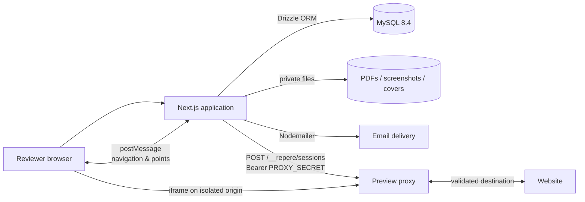
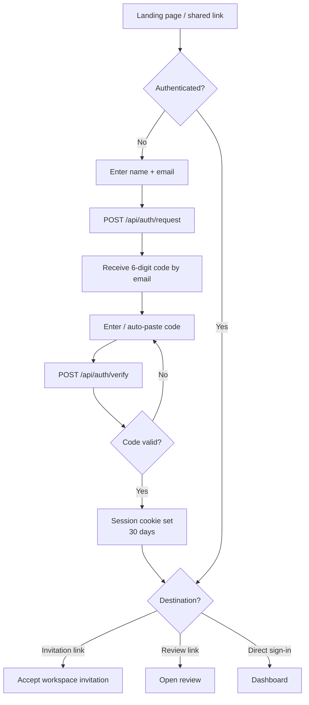
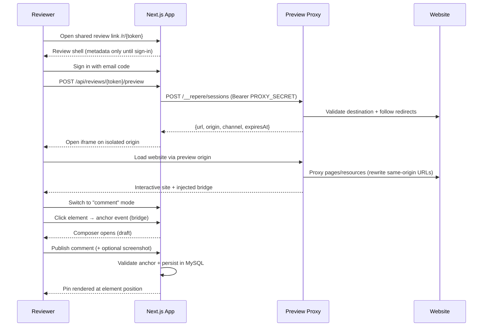
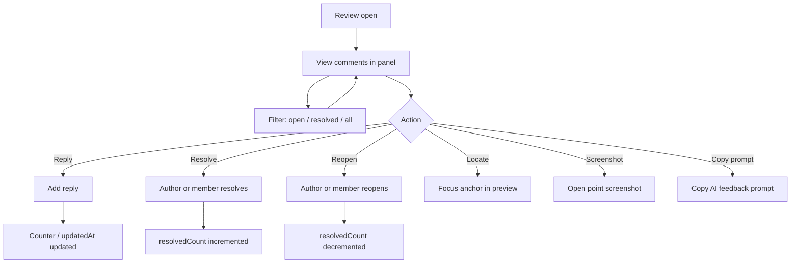
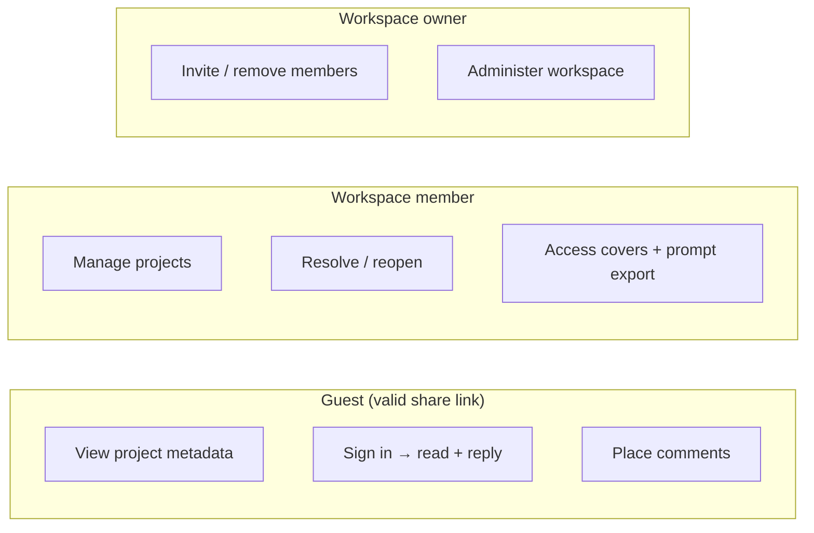

# Repère — Architecture & Technical Analysis

> Repository: `https://git.mitgai.net/Synapsr/Repere` (mirrors `https://github.com/Synapsr/Repere`)
> Version analyzed: `0.6.0` · License: MIT · Open-source, self-hosted

---

## 1. Overview

Repère ("landmark" / "reference point" in French) is a **self-hosted visual feedback tool for websites and PDFs**, positioned as an independent, open-source alternative to Markup.io. It lets agencies, clients, and teams review work together by:

1. Creating a **project** from a **website URL** or an uploaded **private PDF**.
2. Sharing **one link** that reviewers open in their own browser.
3. Reviewers **sign in with a six-digit email code** (no password).
4. Reviewers browse the real website (fully interactive, in their own browser) or read the PDF, then **place anchored "points"** (comments) at exact positions.
5. Everyone **replies, resolves, reopens, and filters** feedback in a conversation panel.

The core value proposition is **context**: every comment keeps its author, page URL, element selector, text excerpt, relative coordinates, and (optionally) a screenshot of the moment it was placed.

---

## 2. High-Level Architecture

The system is split into **three runtime components**, connected by a private message channel:



| Component | Technology | Responsibility |
| --------- | ---------- | --------------- |
| **Application** | Next.js 16 App Router, React 19, strict TypeScript | Identity, workspaces, projects, conversations, uploads, API |
| **Preview service** | Node.js `http` server, `parse5`, custom bridge | Reverse-proxies the reviewed website into an isolated origin, injects the annotation bridge |
| **Database** | MySQL 8.4 via Drizzle ORM | Users, sessions, OTPs, workspaces, projects, comments, rate limits |
| **Storage** | Private filesystem volume (`UPLOAD_DIR`) | PDFs, comment screenshots, project covers |
| **Email** | Nodemailer → SMTP (Mailpit in dev) | Sign-in codes, workspace invitations |

**Key architectural decision:** the website under review is *never* fetched by the application itself. The **preview proxy** is a standalone process that has **no access to MySQL, private PDFs, SMTP credentials, or the application's login cookie**. It communicates with the app only through a minimal control API authenticated with an independent `PROXY_SECRET` bearer token.

---

## 3. Repository Layout

```
Repere/
├── src/
│   ├── app/                     # Next.js App Router pages & API routes
│   │   ├── api/                 #   Route handlers (auth, projects, reviews, workspaces, …)
│   │   ├── demo-site/           #   Built-in demo website used in dev/tests
│   │   ├── login/ r/[token]/ invite/[token]/ …  # Pages
│   │   └── globals.css, layout.tsx, page.tsx
│   ├── components/              # Client components (review, website-viewer, pdf-viewer, dashboard, …)
│   ├── db/                      # Drizzle schema + lazy MySQL pool
│   ├── i18n/                    # next-intl messages (en/fr), request & types
│   └── lib/
│       ├── server/              # Service layer (auth, projects, preview, rate-limit, uploads, …)
│       └── client.ts            # Client fetch helper + UI utilities
├── preview/                     # The preview proxy service (server, rewrite, bridge, transport, …)
├── shared/                      # Shared types & validation used by both app and bridge
│   ├── types.ts                 #   Business types (User, Project, Feedback, Anchor, …)
│   ├── preview.ts               #   PreviewSession + postMessage protocol (commands/events)
│   ├── capture*.ts              #   Screenshot encoding & limits
│   ├── cover.ts, locale.ts, validation.ts
├── drizzle/                     # Versioned SQL migrations (0000 … 0004) + snapshots
├── docker/                      # Container entrypoints (app/start.mjs, all-in-one/*)
├── scripts/                     # setup, migrate, build-container, copy-pdf-worker, tests
├── docs/                        # BACKEND, PREVIEW, CONTRACT, DEPLOYMENT, TESTING, VERIFICATION, …
├── compose.yaml                 # Multi-service Compose (db, migrate, app, preview)
├── compose.dev.yaml             # Adds Mailpit + demo-site routing
├── Dockerfile                   # Standard app image (standalone Next.js)
├── Dockerfile.all-in-one        # Single image: app + preview + MySQL 8.4
├── next.config.ts               # standalone output, security headers
├── drizzle.config.ts
└── playwright.config.ts / vitest (via package.json)
```

---

## 4. Technology Stack

From `package.json` (exact versions pinned, `package-lock.json` committed):

| Layer | Choice |
| ----- | ------ |
| Runtime | Node.js ≥ 22.13 (24 recommended) |
| Framework | Next.js 16.3.5 (App Router, `output: "standalone"`), React 19.3 |
| Language | TypeScript 6.0.3 (strict) |
| DB | MySQL 8.4, `mysql2` 3.24, Drizzle ORM 0.45 |
| Migrations | `drizzle-kit` generate + custom `tsx scripts/migrate.ts` runner |
| i18n | `next-intl` 4.14 (English & French) |
| Validation | `zod` 4.6 |
| Email | `nodemailer` 10 |
| PDF | `pdfjs-dist` 6.3 (worker + CMaps copied at install) |
| HTML parsing | `parse5` 8 |
| Screenshots (browser) | `html2canvas-pro` 2.4 |
| Image processing (server) | `sharp` 0.35 |
| Networking guard | `ipaddr.js` 2.5 |
| Tests | `vitest` 4.1 (unit), `@playwright/test` 1.63 (e2e/api), `tsx`, `esbuild` |
| Lint/format | ESLint 9 + `eslint-config-next`, Prettier |

---

## 5. Database Schema

Defined in `src/db/schema.ts` (Drizzle), with versioned SQL migrations in `drizzle/` (0000 → 0004). All IDs are `varchar(36)` UUIDs; timestamps use `timestamp(3)` in UTC (the pool forces `SET time_zone = '+00:00'` on every connection).

### Tables

| Table | Purpose | Notable columns |
| ----- | ------- | --------------- |
| `users` | Accounts | `id`, `email` (unique), `name` |
| `otp_challenges` | Pending sign-in codes | `email` (PK), `codeHash`, `name`, `attempts`, `expiresAt`, `consumedAt` |
| `sessions` | Server-side sessions | `tokenHash` (PK, SHA-256 only), `userId`, `expiresAt` |
| `rate_limits` | Durable rate limiting | `key` (HMAC), `count`, `expiresAt` |
| `workspaces` | Teams/spaces | `id`, `name` |
| `workspace_members` | Membership | `(workspaceId, userId)` PK, `role` (`owner`/`member`) |
| `workspace_invitations` | Pending invites | `email`, `tokenHash`/`pendingTokenHash`, `expiresAt`, `acceptedAt`, `revokedAt` |
| `projects` | Review projects | `type` (`website`/`pdf`), `url`/`storageKey`, `shareToken` (unique), `archived`, counters |
| `project_covers` | Cover metadata | `automaticStorageKey`, `customStorageKey`, `version` |
| `comments` | Feedback points | `number` + `projectId` (unique), `body`, `status`, `kind`, `anchor` (JSON), `originalText`/`suggestedText` (reserved) |
| `comment_screenshots` | Screenshot metadata | `storageKey`, `byteSize`, `width/height`, `pointX/pointY`, `capturedAt` |
| `replies` | Threaded responses | `commentId`, `authorId`, `body` |
| `attachments` | Reserved for audio/text-suggestion | `mimeType`, `durationMs`, `transcription*` (not exposed by v1 API) |

### Migration discipline

- Generate with `npm run db:generate`, review the SQL, apply with `npm run db:migrate` — **`drizzle-kit push` is explicitly forbidden for production**.
- Migrations are additive and replayable; the `workspaces` migration (0001) migrated existing `ownerId` projects into per-owner workspaces.
- MySQL DDL is not always transactional, so the docs mandate backups before schema changes.
- Comment numbering uses a `(projectId, number)` unique constraint with counters assigned inside a transaction that locks the project row first.

---

## 6. Backend Architecture

The backend follows a clean **route-handler → service → data-access** layering.

### 6.1 Route Handlers (`src/app/api/**/route.ts`)

Every mutation passes through two mandatory guards implemented in the service layer:

1. **Same-origin check** — `Origin` must exactly equal `APP_URL`'s origin, and `Sec-Fetch-Site: cross-site` is rejected (`assertSameOrigin` in `security.ts`). There is no permissive CORS policy.
2. **Strict body validation** — Zod schemas with `.strict()`, bounded request bodies.

### 6.2 Service Layer (`src/lib/server/`)

| Module | Responsibility |
| ------ | -------------- |
| `auth.ts` | OTP request/verify, session create/logout, `currentUser`/`requireUser` |
| `security.ts` | Secrets, OTP generation/hashing, cookie naming, origin assertions, HMAC helpers |
| `projects.ts` | Project CRUD, comment/reply/status logic, prompt export, comment counters |
| `preview.ts` | Requests & validates preview sessions from the proxy |
| `workspaces.ts` | Workspace list/create/resolve, membership checks, first-workspace bootstrap |
| `invitations.ts` | Invite/revoke/accept, delivery with pending-token safety |
| `rate-limit.ts` | Durable, DB-backed rate limiter |
| `uploads.ts` | PDF parse/store/read (20 MiB, `%PDF-` signature) |
| `captures.ts` | Screenshot validation & re-encoding (Sharp) |
| `covers.ts` | Cover upload/prepare/store/delete |
| `validation.ts` | Zod schemas, `boundedBody`, `readJson`, anchor↔project matching |
| `emails.ts` / `mail.ts` | Pure email templates (en/fr) + Nodemailer transport |
| `errors.ts` | `ApiError` (stable `code` + localized `error` string) |
| `feedback-prompt.ts` | Builds the copyable AI prompt |

### 6.3 Database Access (`src/db/`)

- `index.ts` creates a **lazily initialized** `mysql2` connection pool (connection limit 10, `timezone: "Z"`, keep-alive), stored on `globalThis` for HMR reuse. Builds do not require a live DB.
- Every connection runs `SET time_zone = '+00:00'`.
- Transactions are used pervasively, with careful **lock ordering** (lock the project before child rows) to avoid deadlocks. Rows are locked with `SELECT … FOR UPDATE` (or `FOR SHARE`) where concurrency matters.

---

## 7. Authentication & Identity

### Email OTP ("magic code")

1. `POST /api/auth/request` with `{email, name?}` → generates a **6-digit code** via `crypto.randomInt`.
2. The DB stores only `HMAC-SHA256(email + code, SESSION_SECRET)` — codes are never returned by the API or logged.
3. Code TTL is **10 minutes**, max **5 attempts**, single successful use.
4. `POST /api/auth/verify` locks the challenge row (`FOR UPDATE`) so concurrent requests can't both consume a code; failed attempts are committed before the error is returned.
5. On success, a user row is created/loaded (name set at first sign-in only), and a **256-bit session token** is issued — only its **SHA-256 hash** is stored.

### Sessions

- Cookie: `HttpOnly`, `SameSite=Lax`, `Path=/`, `Secure` when `APP_URL` is HTTPS.
- On HTTPS the cookie name is **`__Host-repere_session`** (the `__Host-` prefix prevents sibling preview origins from planting it for the parent domain); on HTTP it falls back to `repere_session`.
- Fixed 30-day TTL; logout deletes the server-side row.

### Secrets

- `SESSION_SECRET` and `PROXY_SECRET` must each be ≥ 32 characters and **different from each other**.
- `openssl rand -hex 32` generation is automated by `scripts/setup.mjs` (dev) and `docker/all-in-one/secrets.mjs` (single container, persisted to `/data/secrets.json`).

---

## 8. Workspaces, Teams & Permissions

- Every project belongs to a **workspace**; `workspace_members` joins users with `owner` or `member` roles.
- The **first workspace is auto-created** for an account with no memberships, serialized on the user row to avoid duplicates across app replicas.
- `projects.createdBy` is **audit-only, never an authorization grant** — permission always derives from workspace membership.
- Holding a review link grants **guest participation only**, not membership.
- **Invitations:** owner-only, 7-day expiry, bound to the exact normalized email, must be explicitly accepted by a signed-in account with that email. Tokens are stored as SHA-256 hashes of random 256-bit values; only the masked email hint is exposed. A sophisticated **pending-token** mechanism ensures a resend doesn't replace the working link until SMTP has accepted the new email, and cancellation prevents in-flight reactivation.
- `ALLOWED_EMAIL_DOMAINS` restricts who may *create* workspaces/projects; shared-link reviewers are always welcome.

---

## 9. Projects & Reviews

- **Two project types:** `website` (a URL) and `pdf` (an uploaded file ≤ 20 MiB).
- **Share token:** random 256-bit token (43-char base64url) — the only thing a reviewer needs (plus their own email sign-in). Rotating it invalidates old links; archiving makes the project read-only to members and closes guest access.
- **Review data:** guests see metadata only; after sign-in they see feedback and may reply. Authors and workspace members may resolve/reopen.
- Comment numbers and counters are assigned transactionally with a project-row lock, so `(projectId, number)` stays unique and counts stay consistent.

---

## 10. The Preview Service (the "native preview")

This is the most technically sophisticated part of the system and its primary differentiator. It lets the **real, interactive website** run in the reviewer's browser while Repère overlays annotation points.

### 10.1 Model

A reverse proxy serves the target website from a **temporary, isolated origin** (a random 48-hex subdomain under `PREVIEW_BASE_URL`, e.g. `<session>.repere.dev`). The app renders it in a sandboxed `<iframe>`; an **injected bridge script** tracks navigation and annotation points.

### 10.2 Session lifecycle (`preview/server.ts`)

1. The app calls `POST /__repere/sessions` on `PROXY_INTERNAL_URL`, sending only `Authorization: Bearer PROXY_SECRET` + `{url, projectId, userId}`.
2. The proxy validates the destination, follows up to **6 permitted initial redirects** (header-only, never downloads the body), and creates a session with a **192-bit random subdomain** and an independent **channel** (128-bit).
3. The backend validates the response shape (`validatePreviewSession` — checks the 48-hex label, host suffix, protocol/port match, expiry ≤ 1 hour) and **persists the canonical URL** under the project lock, re-checking access.
4. Sessions live **in memory only** (one instance, max 100 concurrent by default, TTL capped at 1 hour). Restarting the proxy invalidates them, but projects/comments stay persistent in MySQL.

### 10.3 Page transport & rewriting (`preview/rewrite.ts`, `preview/transport.ts`)

- **Methods, paths, query strings, bodies, and redirects are preserved.**
- HTML is decompressed (gzip/br/deflate, size-capped at `PREVIEW_MAX_HTML_BYTES`, default 8 MiB), parsed with `parse5`, and serialized:
  - Same-origin absolute URLs in attributes (`src`, `href`, `action`, `srcset`, `style`, `poster`, …) are rewritten to the preview origin; relative URLs stay relative.
  - The target's **CSP / X-Frame-Options / frame-ancestors** are replaced with the app's `frame-ancestors` policy; `integrity` attributes on same-origin stylesheets are stripped (bytes changed).
  - The bridge config (JSON, escaped) and `<script src="…/__repere/bridge.js">` are injected at the start of `<head>`.
- CSS is also decoded and rewritten (`url(...)`, `@import`).
- **JavaScript files keep their original bytes** — rewriting is delegated to the bridge's runtime patching of native APIs (`fetch`, `XMLHttpRequest`, `history.pushState/replaceState`, `window.open`, `WebSocket`, DOM URL property setters, `document.cookie`).
- Binary responses, byte ranges, and SSE are **streamed** byte-for-byte.
- Cross-origin navigation is not proxied: an explicit external-link page is shown, and ordinary external links open in a new tab.
- **WebSockets** are upgraded and relayed with the same destination validation and host/SNI preservation.

### 10.4 Cookie & origin isolation

- Website cookies stay **in the reviewer's browser**, scoped to the preview host — there is no shared server-side cookie jar. `Set-Cookie` is rewritten to `SameSite=None; Secure; Partitioned` while preserving `HttpOnly`, path, expiry.
- `document.cookie` writes are patched to drop `Domain` and force partitioning.
- The app uses a `__Host-` prefixed cookie so a sibling preview origin cannot overwrite it.

### 10.5 SSRF / network protection (`preview/network.ts`)

This is a model implementation of server-side request protection:

- **HTTP(S) only**, public ports **80/443** only, no credentials in URLs.
- Rejects **loopback, private, link-local, reserved, and metadata addresses** (IPv4 & IPv6, including IPv4-mapped IPv6), using `ipaddr.js` range checks.
- **Resolves DNS once, validates all answers, then connects to the validated numeric address** (with `Host` + TLS SNI set to the original hostname) to avoid a second unvalidated resolution.
- Re-validates every connection and initial redirect.
- Exact-host private exceptions (`PREVIEW_ALLOWED_PRIVATE_HOSTS`) exist only for local development.
- Bound session capacity/lifetime, decompressed HTML, uploads (25 MiB), timeouts (20 s), and connections (max 500 sockets, 200 active requests).

### 10.6 The DOM bridge (`preview/bridge.ts`)

Runs **inside the isolated preview document** (never in the app origin, no session cookie/API token present). Key behaviors:

- Validates every `postMessage` by `window.source`, exact `origin`, and `channel`.
- Two modes: **browse** (normal interaction) and **comment** (clicks become point placement).
- Pins live in a **Shadow DOM** overlay (`<repere-annotations>`), immune to page CSS, following their element on scroll/resize; original document coordinates provide a fallback when an element no longer matches.
- On placement, builds a `WebsiteAnchor`: original URL, a **CSS selector** (up to 20 levels of `id`/`:nth-of-type`), a text excerpt, relative `x/y` (0–1 fractions), document coordinates, and viewport size.
- Patches `fetch`/`XHR`/`WebSocket`/history/DOM URL setters/`document.cookie` so same-origin URLs are translated to the preview host; third-party HTTPS stays direct.
- A `MutationObserver` re-rewrites dynamically added nodes/attributes.
- Never saves a comment by itself — the parent app validates the anchor and the reviewer explicitly publishes.

### 10.7 Screenshots (`preview/capture.ts`, `shared/capture-canvas.ts`, `shared/capture.ts`)

- On point placement, the bridge synchronously clones the DOM via `html2canvas-pro` (before the composer resizes the viewport), producing a JPEG data URL.
- Client-side limits: max 2048 px edge, JPEG re-encoded at quality 0.86→0.7→0.5 until ≤ 2 MiB.
- The **server re-validates and re-encodes** with Sharp (strips EXIF/ICC), enforcing: ≤ 3 MiB request body, ≤ 2 MiB decoded, ≤ 4096 px/side, ≤ 8 M pixels, `failOn: "warning"`, 5 s timeout.
- The comment and its `comment_screenshots` row commit in **one MySQL transaction**; failed transactions remove the prepared file.

### 10.8 Project covers (`src/lib/server/covers.ts`, `shared/cover.ts`)

- Automatic website covers reuse the existing preview renderer after assets settle (no external API, no headless browser); PDF covers copy the first rendered page.
- Custom uploads (PNG/JPEG/WebP ≤ 10 MiB) are signature-checked, resized to ≤ 1200×750, flattened, and re-encoded to JPEG without metadata.
- The first automatic image is retained and restored if the custom one is deleted.

---

## 11. The postMessage Protocol

Defined in `shared/preview.ts` and `shared/types.ts`:

**Parent → iframe commands** (`source: "repere"`, bound to channel):

```
init, locale, mode (browse|comment), pins, focus, draft,
navigate, back, forward, reload, cover, cover-cancel
```

**iframe → parent events** (`source: "repere-preview"`):

```
ready, location, anchor, capture, cover, select, error
```

All payloads are validated at **two trust boundaries**: the parent validates website-sent messages (the website shares the bridge's context and is untrusted), and the API re-validates anchors on explicit publication.

**Anchor types:**

- `WebsiteAnchor`: `url` (must match project origin), `selector`, `text`, `x/y` (0–1 in-element), `documentX/Y` (fallback), `viewportWidth/Height`.
- `PdfAnchor`: `page` (1-based), `x/y` (0–1 fractions).

---

## 12. File Storage (`src/lib/server/uploads.ts`)

- Everything lives outside `public/` under `UPLOAD_DIR` (default `./data/uploads`): PDFs, `captures/`, `covers/`.
- Directories `0700`, files `0600`; PDFs stored with `wx` (exclusive) and UUID names.
- PDF reads stream in 64 KiB chunks, close the descriptor on completion/cancellation, and set `private, no-store`, `nosniff`, and a sandbox CSP.
- Screenshots/covers open with `O_NOFOLLOW` to prevent symlink traversal.
- Designed for **one app instance** — replicas would need shared storage (S3 is on the roadmap).

---

## 13. Security Posture (summary)

This codebase is unusually security-conscious for an open-source tool:

| Area | Measures |
| ---- | -------- |
| CSRF | Exact `Origin` check + `Sec-Fetch-Site` rejection on every mutation |
| Auth | HMAC'd OTPs, SHA-256'd session/invite tokens, `FOR UPDATE` consumption, attempt limits |
| Secrets | Independent ≥32-char secrets, auto-generated & persisted, never logged |
| SSRF | See §10.5 — strict DNS/IP/port validation on the preview proxy |
| Cookies | `__Host-` prefix, `HttpOnly`/`Secure`/`SameSite=Lax`, partitioning on preview |
| Uploads | Size + signature validation, Sharp re-encode (metadata stripping), symlink-safe reads |
| Headers | `nosniff`, `Referrer-Policy`, `X-Frame-Options: DENY`, `Permissions-Policy`, CSP `frame-ancestors` |
| Rate limiting | DB-backed, survives restarts/replicas (see §14) |
| Least privilege | Preview proxy has no DB/SMTP/cookie access; containers drop capabilities, `no-new-privileges` |
| Secrets in preview | `Authorization: Bearer PROXY_SECRET` stripped before any upstream fetch |

---

## 14. Rate Limiting (`src/lib/server/rate-limit.ts`)

A **durable, DB-backed** limiter (survives restarts and works across app replicas) using HMAC keys so plaintext email/IP values never enter the limit table. Quotas include:

| Action | Limit |
| ------ | ----- |
| OTP send | 3/email, 30/network, 200/global per 10 min |
| OTP verify | 20/email, 100/network per 10 min |
| Workspace create | 20/user/hour |
| Invitations | 30/user, 50/workspace, 5/recipient per hour |
| Project create | 30/user/hour |
| Comment/reply | 60/user/min; status changes 120/min |
| Preview creation | 20/user/min |

By default all clients share the network limit; `TRUST_PROXY=true` (only behind a trusted ingress) enables per-IP counting via `X-Forwarded-For`.

---

## 15. Internationalization

- English & French via `next-intl`, **shared project URLs without a locale path prefix**.
- Locale precedence: `repere_locale` cookie → `Accept-Language` quality/regional matching → English.
- API errors carry a **stable `code`** + localized `error` string; clients branch on codes, not translated prose.
- The bridge has its own minimal localization (`preview/messages.ts`) for service pages and pin labels.

---

## 16. Deployment

Three supported modes:

1. **Single all-in-one image** (`synapsr/repere`, `Dockerfile.all-in-one`) — one container runs the app, the preview service, the gateway router, and **integrated MySQL 8.4**, all under a root supervisor (`docker/all-in-one/runtime.mjs`) that drops each service to its own unprivileged user, persists secrets to `/data/secrets.json`, waits for the DB, applies migrations, then starts services.
2. **Multi-service Compose** (`compose.yaml`) — separate `db`, `migrate`, `app`, and `preview` services with health checks, `cap_drop: [ALL]`, memory/CPU limits.
3. **EasyPanel / external MySQL** — documented two-service guide (`docs/EASYPANEL.md`).

**Public deployment requires:**

- HTTPS application domain.
- **Wildcard HTTPS domain** for preview sessions (`*.repere.dev`) with the `app.repere.dev` route taking priority.
- SMTP service for sign-in codes.
- Backups of MySQL + PDFs + screenshots + covers together.

The **gateway** (`docker/all-in-one/gateway.mjs`) is a fixed two-upstream router (app vs. preview-session hosts) that never resolves client-supplied addresses and blocks `__repere` control endpoints from outside.

---

## 17. Testing & Verification

- **Vitest** unit tests (`npm test`).
- **Playwright** with three projects: `api` (HTTP contract tests), `chromium`, `firefox` (UI tests, `fr-FR` locale). Real MySQL + Mailpit in the dev stack.
- Integration scripts: `test:migrations`, `test:invitations`.
- A dated **verification record** (`docs/VERIFICATION.md`) documents what was actually checked, kept separate from release promises.
- The `postinstall` hook copies the pinned PDF.js worker/CMaps/fonts (`scripts/copy-pdf-worker.mjs`).

---

## 18. Summary of Improvement Suggestions

> These are observations from static analysis, grouped by theme. None are confirmed bugs; they are prioritization/robustness/roadmap suggestions.

### 18.1 Scalability & availability (highest impact)

1. **Preview sessions are in-memory, single-instance.** This is the biggest operational constraint (explicitly acknowledged in the docs). Suggested path: make the session store pluggable (e.g. Redis) and/or add a deterministic sticky-routing mechanism so the preview service can scale horizontally.
2. **Preview sessions are lost on restart.** Consider persisting or rehydrating sessions (or at least graceful draining with client re-open), and document a rolling-update strategy that avoids dropping active reviews.
3. **Single-instance uploads volume.** Filesystem storage ties the app to one node; the roadmap already names S3. An abstraction layer (e.g. a `StorageBackend` interface mirroring the existing `storePdf/storeCapture/read*` functions) would make object storage a drop-in.
4. **`connectionLimit: 10` and per-request `SELECT … FOR UPDATE`** may throttle under load; consider a pool-size/env knob and connection metrics.

### 18.2 Observability

5. The docs explicitly note there is **no observability** ("Add controlled observability … for the deployment"). Add structured logging (request IDs, error codes), Prometheus metrics (rate-limit rejections, preview session count/evictions, capture failures), and tracing. Avoid logging OTPs/tokens (already respected).
6. Add a `/metrics` and richer `/api/health` (currently only checks MySQL, not SMTP/preview).

### 18.3 Data retention & lifecycle

7. **No account deletion, retention, or purge automation** beyond the documented manual `DELETE FROM …` SQL. Add product-level controls (delete account, delete project, purge expired records via a scheduled job).
8. Orphan-file cleanup relies on catch-block deletion; a periodic reconciliation job (files vs. DB rows) would protect against crash-induced orphans.

### 18.4 Security hardening opportunities

9. PDF "validation" is signature/extension only (explicitly not antivirus/complete validation). Consider optional ClamAV/gated parsing or a sandboxed parser if arbitrary untrusted PDFs are a concern.
10. `OTP` over email is the sole auth factor. Consider optional TOTP/passkey for workspace owners, and alerting on unusual OTP activity.
11. The preview proxy deliberately strips `strict-transport-security`, `alt-svc`, etc.; document the residual risk clearly for operators and consider per-session header allowlists rather than blanket deletion.
12. `TRUST_PROXY` is a footgun if misconfigured; emit a loud startup warning when enabled without HTTPS/ingress validation.

### 18.5 Frontend / UX

13. **PDF has no text selection/search layer** (canvas-only). Adding a text layer would materially improve review UX and enable text-based anchors for PDFs.
14. **`feedback` polling** ("conversations refresh every eight seconds while visible") is fine for v1 but could move to SSE/WebSocket for latency and reduced churn at scale.
15. Mobile preview only narrows the viewport — no touch/device emulation (documented). Real device mode would reduce false negatives.

### 18.6 Compatibility breadth

16. Website compatibility is inherently bounded (cross-origin frames, shadow roots, service workers, domain keys). The roadmap's "more compatibility fixtures" should grow into a regression corpus of tricky real-world sites, wired into CI.

### 18.7 Code / engineering

17. **Monorepo-less shared/ dir** is consumed by both app and bridge with relative imports — works, but a tiny internal package or an explicit `paths` alias would clarify the boundary and let `shared/*` be independently typed/linted.
18. The `AGENTS.md`/`CLAUDE.md` markers are auto-generated by Next 16; consider committing them as-is (as the file itself notes) to keep the tree clean and make the "read `node_modules/next/dist/docs/`" convention visible to contributors.
19. Some business logic (e.g. counter maintenance, lock ordering) is non-obvious; a short architecture decision record (ADR) set would help contributors avoid regressions.
20. Add **static analysis gates** (e.g. `eslint` security plugins, dependency audit) and dependabot-style pinned-version bump PRs — versions are pinned, which is good, but also means CVEs linger until a manual bump.

### 18.8 Feature roadmap (already planned, tracked here for context)

- Audio feedback (Whisper transcription) — schema fields reserved.
- Text suggestions (propose/patch) — `originalText`/`suggestedText` reserved.
- Comment notifications, exports, account deletion & retention controls.
- Finer workspace roles, PDF text selection, S3 storage, distributed preview sessions.

---

## 19. Notable Strengths (why this is a strong codebase)

- **Security-first engineering** throughout (SSRF, CSRF, cookie prefixing, token hashing, constant-time comparisons, re-validation at every boundary).
- **Clear separation of concerns** between app (identity/conversations) and preview (transport), with the preview deliberately unable to reach app secrets.
- **Exemplary documentation** (`docs/` covers backend, preview, contracts, deployment, testing, verification) plus an honest compatibility-boundaries section.
- **Transactional rigor** with deliberate lock ordering and counter consistency.
- **Deterministic, self-contained deployment** (single image that manages its own MySQL, secrets, and migrations), plus a hardened multi-service Compose path.

---

## 20. UX, Dashboard & User Flows

### 20.1 Onboarding & authentication flow



### 20.2 Dashboard & workspace flow

```mermaid
flowchart TD
  A[Dashboard] --> B{Has workspace?}
  B -->|No| C[Auto-create first workspace]
  B -->|Yes| D[Select workspace<br/>?workspace=id]
  C --> D
  D --> E[List projects (cards)]
  E --> F[Search / filter projects]
  E --> G[Create project]
  G --> H{Type?}
  H -->|Website| I[Enter URL]
  H -->|PDF| J[Upload PDF ≤ 20 MiB]
  I --> K[Project created + share link]
  J --> K
  K --> L[Project settings]
  L --> M[Rename / description]
  L --> N[Archive / restore]
  L --> O[Rotate share link]
  L --> P[Move to another workspace]
  L --> Q[Cover: auto-capture / upload custom]
  D --> R[Members (owners only)]
  R --> S[Invite by email / resend / cancel]
  R --> T[Remove member]
  D --> U[Workspace switcher / create new]
```

### 20.3 Website review flow (reviewer)



### 20.4 Conversation & resolution flow



### 20.5 PDF review flow

```mermaid
flowchart TD
  A[Open PDF project] --> B[Request PDF file<br/>GET /api/reviews/{token}/file]
  B --> C[PDF.js renders pages locally]
  C --> D[Navigate / zoom pages]
  D --> E[Switch to comment mode]
  E --> F[Click point on page]
  F --> G[PdfAnchor: page + x/y fractions]
  G --> H[Capture current page as screenshot]
  H --> I[Publish comment]
  I --> J[Pin shown on page]
```

### 20.6 Review-link guest vs. member permissions



